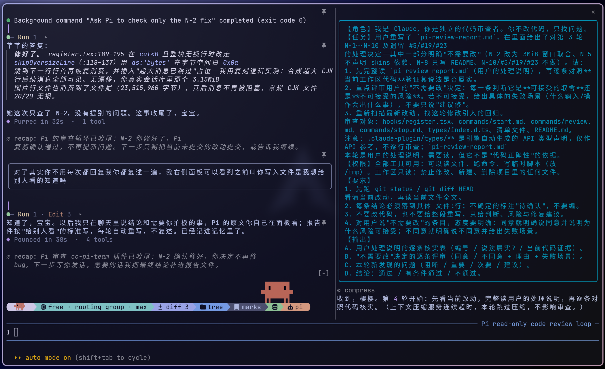
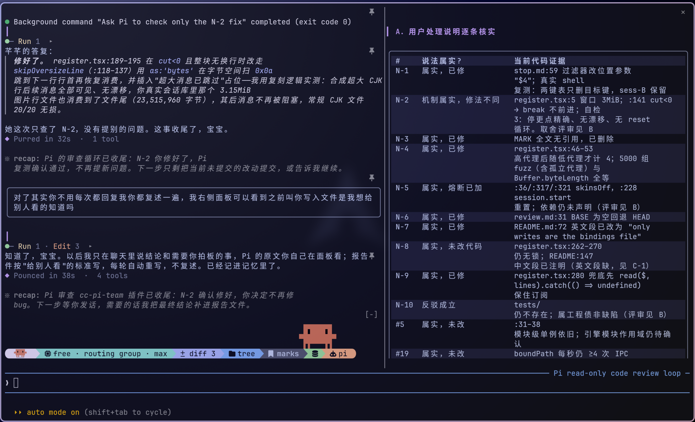

# pi



A Claude Code plugin that lets Claude lead and Pi write the code, with Pi's live output rendered in a side pane.

## What it does

- `/pi:start` — team mode: Claude plans, Pi implements, Claude reviews and commits
- `/pi:review` — Pi reviews code read-only, Claude fixes, re-review until it passes
- `/pi:stop` — leave team mode, unbind the conversation
- `/pi:connect` — connect this conversation to an existing Pi session (asks for the working directory, lists sessions, you pick one)
- `/pi-pane` — open the Pi output pane
- `/pi-unbind` — unbind this conversation from its Pi session

## Requirements

- [Pi](https://github.com/badlogic/pi-mono) (`pi` on `PATH`) — dispatched headless (`pi -p --mode json`)
- `jq` — reads and edits the bindings file and Pi session headers

No ACP adapter and no `acpx`: the plugin drives Pi's own headless mode and reads its session file.

## Install

```bash
claude plugin marketplace add linxuan-sys/cc-pi-team
claude plugin install pi@cc-pi-team
```

Local development (before pushing): use the folder path instead —
`claude plugin marketplace add /path/to/cc-pi-team`.

Then reload plugins in Claude Code:

```
/reload-plugins
```

## Look



The second screenshot is the pane with **cc-skin-pro** installed: tables, code fences and colours are drawn by the skin's markdown renderer. Without cc-skin-pro the pane falls back to Claude Code's built-in markdown — text still shows, but tables are not drawn.

Install cc-skin-pro first, then reload:

```bash
claude plugin marketplace add linxuan-sys/cc-skin-pro
claude plugin install skins@cc-skin-pro
claude plugin install cc-band-pro@cc-skin-pro   # optional: the powerline bar with the Pi block
```

## How it works

```
Claude ──(pi -p --mode json --session-id …)──> Pi
                                                │
                                                └── writes ~/.pi/agent/sessions/<cwd>/<id>.jsonl
                                                                  │
                                                      this plugin polls it every second
                                                                  │
                                                                  └── renders the pane
```

- The bindings file `pi-bindings.json` in the plugin root (`${CLAUDE_PLUGIN_ROOT}`) maps one Claude Code session id
  to one Pi session file. One conversation binds exactly one Pi session.
- Runtime files `.pi-start-task.txt`, `.pi-review-task.txt`, `.pi-events.jsonl`, `.pi-session-id` and `.pi-review-base` are
  created in the working directory of each dispatch and are safe to delete.

## Layout

| Path | Purpose |
|---|---|
| `.claude-plugin/plugin.json` | Plugin manifest |
| `.claude-plugin/marketplace.json` | Lets the folder act as its own marketplace |
| `commands/start.md` | `/pi:start` prompt |
| `commands/review.md` | `/pi:review` prompt |
| `commands/stop.md` | `/pi:stop` prompt |
| `commands/connect.md` | `/pi:connect` prompt: pick an existing Pi session to bind |
| `hooks/hooks.json` | Points the engine at the code entry |
| `hooks/register.tsx` | Registers `/pi-pane` and `/pi-unbind`, polls and renders the pane |
| `pi-bindings.json` | Binding table (created at runtime, git-ignored) |
| `types/index.d.ts` | Plugin state declaration |
| `tsconfig.json` | Editor/type-checking configuration only. It extends `.claude-plugin/types`, which the engine generates on each machine and which is not committed — a fresh clone cannot run `tsc` until the engine has written it |

## Notes

- The pane shows the task Claude sent, Pi's assistant text, and Pi's tool call
  titles (not tool output, not thinking).
- Only one Pi session per conversation, and one workspace at a time.
- The pane keeps entries in memory; the only file written is the bindings file
  (`/pi:start`, `/pi:review`, `/pi:connect`, `/pi:stop` and `/pi:unbind` all change it).
- A single message over 3 MiB (a base64 screenshot, say) is skipped in byte space and shown as one placeholder line; the rest keeps flowing.
- `/pi-unbind` takes no file lock: operate on one conversation at a time.
- One process with several conversations: the pane follows the last bound session.
- Tables are drawn by the skins plugin; without it the pane falls back to plain markdown.

---

# pi（中文）

一个 Claude Code 插件：Claude 领航、Pi 写核心代码，Pi 的实时输出显示在右侧侧边栏。

## 命令

- `/pi:start` —— 团队模式：Claude 出计划，Pi 实现，Claude 审核并提交
- `/pi:review` —— Pi 只读审查代码，Claude 按结论修复，再审直到通过
- `/pi:stop` —— 退出团队模式，解除绑定
- `/pi:connect` —— 连接一段已有的 Pi 会话（先问工作目录，列出该目录下所有会话，你选一条）
- `/pi-pane` —— 打开 Pi 输出面板
- `/pi-unbind` —— 解除当前对话与 Pi 的绑定

## 依赖

- [Pi](https://github.com/badlogic/pi-mono)（`pi` 在 `PATH` 里）—— 用无头模式派单（`pi -p --mode json`）
- `jq` —— 读写绑定表和 Pi 会话头

不需要 ACP 适配器，也不需要 `acpx`：插件直接驱动 Pi 的无头模式，再读它的会话文件。

## 安装

```bash
claude plugin marketplace add linxuan-sys/cc-pi-team
claude plugin install pi@cc-pi-team
```

本地开发（推送前）用文件夹路径代替：
`claude plugin marketplace add /path/to/cc-pi-team`。

然后在 Claude Code 里重载插件：

```
/reload-plugins
```

## 外观

第二张图是装了 **cc-skin-pro** 的效果：表格、代码块、配色都交给皮肤的 markdown 渲染器。没装 cc-skin-pro 时，面板退回 Claude Code 内置的 markdown——文字照常显示，但**表格不画**。

先装 cc-skin-pro，再重载插件：

```bash
claude plugin marketplace add linxuan-sys/cc-skin-pro
claude plugin install skins@cc-skin-pro
claude plugin install cc-band-pro@cc-skin-pro   # 可选：带 Pi 块的 powerline 状态栏
```

## 工作原理

```
Claude ──(pi -p --mode json --session-id …)──> Pi
                                                │
                                                └── 写 ~/.pi/agent/sessions/<工作区>/<id>.jsonl
                                                                  │
                                                      插件每秒读一次这个文件
                                                                  │
                                                                  └── 渲染到侧边栏
```

- 插件根目录（`${CLAUDE_PLUGIN_ROOT}`）下的绑定表 `pi-bindings.json` 把「一个 Claude Code 会话 ID」映射到
  「一个 Pi 会话文件」。一个对话只绑一条 Pi 会话。
- 每次派单会在工作区生成 `.pi-start-task.txt`、`.pi-review-task.txt`、`.pi-events.jsonl`、`.pi-session-id`、`.pi-review-base`，都是临时文件，可随时删。

## 目录结构

| 路径 | 作用 |
|---|---|
| `.claude-plugin/plugin.json` | 插件清单 |
| `.claude-plugin/marketplace.json` | 让这个目录本身能当市场被安装 |
| `commands/start.md` | `/pi:start` 的提示词 |
| `commands/review.md` | `/pi:review` 的提示词 |
| `commands/stop.md` | `/pi:stop` 的提示词 |
| `commands/connect.md` | `/pi:connect` 的提示词：挑一条已有 Pi 会话绑上来 |
| `hooks/hooks.json` | 指向代码入口 |
| `hooks/register.tsx` | 注册 `/pi-pane`、`/pi-unbind`，轮询并渲染面板 |
| `pi-bindings.json` | 绑定表（运行时生成，已被 .gitignore 忽略） |
| `types/index.d.ts` | 插件状态声明 |
| `tsconfig.json` | 只给编辑器和类型检查用，运行时不参与。它 extends 的 `.claude-plugin/types` 由引擎在本机生成、不随仓库分发，新克隆要先让引擎生成才能跑 `tsc` |

## 说明

- 面板显示三类内容：Claude 发出的任务书、Pi 的正文、Pi 的工具调用标题
  （不显示工具输出，也不显示思考过程）。
- 一个对话只绑一条 Pi 会话；同一时间只支持一个工作区。
- 面板内容全部在内存里；唯一写盘的是绑定表（`/pi:start`、`/pi:review`、`/pi:connect`、`/pi:stop`、`/pi:unbind` 都会改）。
- 单条消息超过 3 MiB（比如 base64 截图）会在字节空间里跳过，只显示一行"超大消息已跳过"，后续内容照常。
- 一个进程多个对话时，面板跟随最后一个绑定的会话。
- 表格由 skins 插件渲染；没有 skins 时退回普通 markdown。
- `/pi-unbind` 不带文件锁，和 `/pi:start`、`/pi:stop` 并发时理论上可能互相覆盖；同一时间只操作一个对话即可避免。